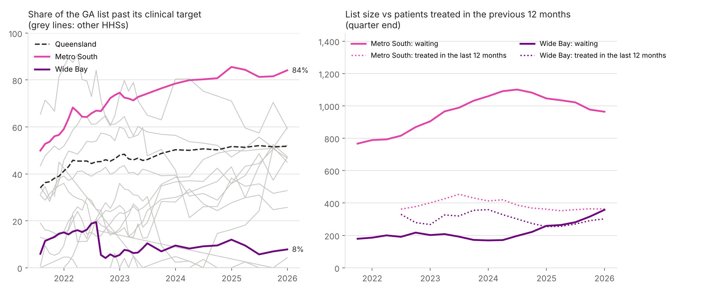
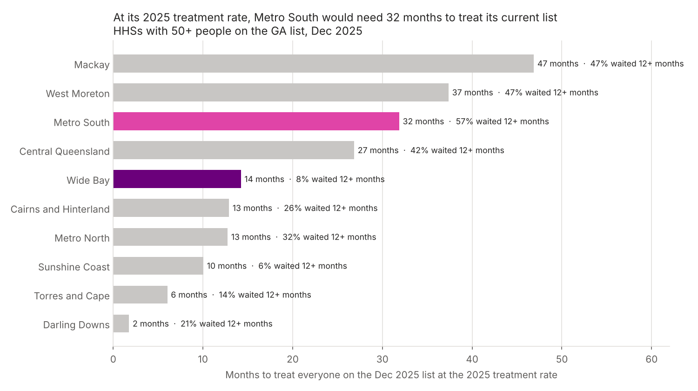
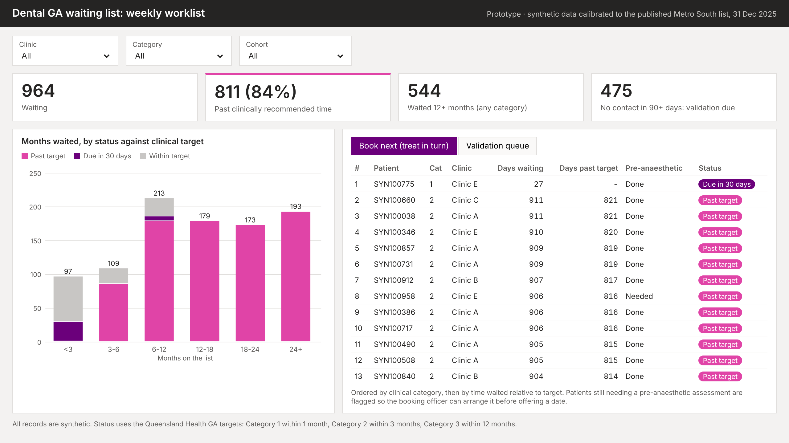

# Dental general anaesthetic waiting lists: a business case for Metro South



Some dental treatment can only be done under general anaesthetic (GA): young children with extensive decay, and adults with intellectual disability or other additional needs who can't be treated in the chair. In Queensland's public system these patients join a GA waiting list with a clinically recommended time of 1, 3 or 12 months.

My [water fluoridation project](../qld-water-fluoridation/) found that this list had almost tripled since 2016, and that health services performed very differently against target. This case picks up that finding and works it through the way a business analyst would for an HHS executive: size the problem, find where it comes from, compare against the best performer, cost the options and specify what would need to be built.

**Scope:** desk-based discovery using public data only. No stakeholders were interviewed, so every process finding is a hypothesis. The [questions for stakeholders](docs/06-assumptions-and-discovery-questions.md) are the first deliverable of a real engagement.

## Executive summary

| | |
|---|---|
| Queensland GA list, Dec 2025 | **3,586** waiting, **1,856** past target (52%), up from 2,569 and 875 in Jul 2021 |
| Metro South, Dec 2025 | **964** waiting, **811 past target (84%)**, which is **44%** of all overdue patients in the state |
| Metro South patients waiting 12+ months | **57%** of the list. **397** of them are Category 2 (treat within 3 months) and have waited more than 15 months |
| Time to treat the current Metro South list at the 2025 rate | **32 months** (Wide Bay: 14) |
| Cost of one GA dental episode at the national efficient price | **$5,789** (NEP 2025-26 $7,258 x AR-DRG D40Z weight 0.7976) |

**Three findings drive the recommendation:**

1. **Metro South is no longer losing ground, but it can't recover on its own.** It treated 30 patients a month in 2025 against 23 new net additions, so the list has come down from its 1,101 peak in June 2024. At that surplus of about 7 a month, clearing the 811 overdue patients would take almost 10 years.
2. **The headline "% past target" is not comparable between HHSs.** 83% of Metro South's list is Category 2 (3-month target); Wide Bay lists 100% of its patients as Category 3 (12-month target). A category-neutral measure, the share waiting more than 12 months, narrows the gap (57% vs 8%) but does not close it. Some of the difference is triage practice, some is real.
3. **The benchmark has its own early warning.** Wide Bay's list grew 112% in two years (169 to 358) and it now adds 33 patients a month while treating 25. At that rate a patient joining today would wait about 14 months in turn, already past the 12-month target. Wide Bay's 8% will not hold without action.

## Recommendation: validate first, then buy the capacity that's left

| Option | What it involves | Cost | Result |
|---|---|---|---|
| A. Do nothing | Current capacity | $0 | Overdue backlog takes ~10 years to clear; 3-month patients keep waiting 15+ months |
| B. Validate and re-triage | 6 months of a waitlist officer (AO4) to contact every patient not reached in 90 days; clinical review of every Category 2 patient past 12 months | ~$65k (assumed) | Accurate list and consistent categories. Pays for itself if it removes **11** patients from the list |
| C. Buy capacity only | Extra GA sessions or outsourced private day-hospital lists to clear the backlog in 18 months | ~$4.0m | 38 extra cases a month (+126% on 2025 throughput) |
| **D. B then C (recommended)** | Validate and re-triage in months 0-3, then commission capacity for the list that remains | **$3.1m to $3.6m** if validation removes 10-20% | Backlog cleared in 18 months with 29 to 34 extra cases a month |

Every 10% of overdue patients removed through validation (moved away, treated privately, no longer need GA) saves about **$470k** of purchased capacity. The validation rate is the biggest unknown in the case and is the first thing to measure.

Full figures and assumptions: [business case](docs/01-problem-and-business-case.md).



## Prototype: a weekly worklist for the booking team



A working prototype ([HTML](prototype/waitlist_prototype.html), open it in a browser) built on a synthetic patient-level list calibrated to the published Metro South totals. It covers the three things the requirements say the booking team is missing: a treat-in-turn booking order, a validation queue for anyone not contacted in 90 days, and a category-neutral 12-month measure alongside the official one. In production this would be a Power BI report on the oral health information system, with row-level security by clinic.

## Deliverables

| | Document |
|---|---|
| 1 | [Problem statement and business case](docs/01-problem-and-business-case.md) |
| 2 | [Stakeholder analysis](docs/02-stakeholders.md) |
| 3 | [Current and future state process](docs/03-process-current-and-future.md) |
| 4 | [Root cause analysis](docs/04-root-cause.md) |
| 5 | [Requirements backlog](docs/05-requirements.md) ([CSV](docs/requirements_backlog.csv)) |
| 6 | [Assumptions, data issues and discovery questions](docs/06-assumptions-and-discovery-questions.md) |
| 7 | [Roadmap, KPIs and risks](docs/07-roadmap-kpis-risks.md) |

## Data

| Source | What |
|---|---|
| [Queensland Health public dental waiting lists](https://www.data.qld.gov.au/dataset/public-dental-waiting-list) | 34 releases, Jul 2021 to Dec 2025 (monthly to June 2023, quarterly after). GA Categories 1-3 by clinic, months waited and patients treated |
| [IHACPA National Efficient Price Determination 2025-26](https://www.ihacpa.gov.au/resources/national-efficient-price-determination-2025-26) | NEP $7,258 per NWAU(25); AR-DRG V11.0 D40Z Dental Extractions and Restorations, inlier price weight 0.7976 |
| [Queensland Health administrative stream wage rates](https://www.health.qld.gov.au/hrpolicies/salary/admin) | AO4 pay point 4, $103,572 from 1 September 2025 |

## Run it

```bash
pip install -r requirements.txt
python ga_waitlist_analysis.py                 # analysis, charts, scenario tables
python prototype/make_synthetic_list.py        # rebuilds the synthetic list and the prototype
```

---
Tina Orecchia · Data & Business Analyst with a background in dentistry · Brisbane
