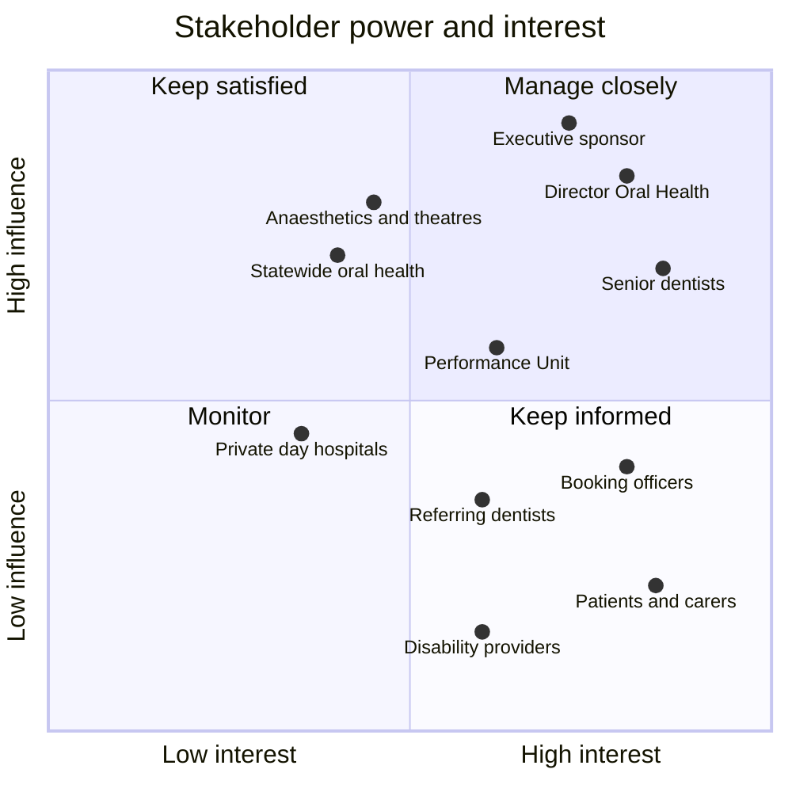

# 2. Stakeholder analysis

Roles are generic: no individuals were contacted.

## Stakeholder register

| Stakeholder | Interest in the change | Influence | What they need from this work | Engagement |
|---|---|---|---|---|
| HHS Executive Director, Clinical Services | Published performance; funding decisions | High | A costed, staged option they can approve | **Sponsor.** Decision paper at gates 1 and 2 |
| Director, Oral Health Services | Clinical risk on the list; team workload | High | Capacity without losing control of clinical priority | **Business owner.** Fortnightly working group |
| Senior dentists / paediatric dentists | Patients they assessed are deteriorating | High | Consistent triage criteria; time protected for re-triage | Co-design the re-triage protocol |
| Anaesthetics and perioperative services | Theatre time shared with other specialties | High | Predictable session requests; full lists, few cancellations | Theatre planning meeting; agree session fill targets |
| Waitlist and booking officers | Run the list day to day | Medium | A worklist instead of spreadsheets; clear scripts for validation calls | Process walk-through; prototype testing |
| HHS Performance Unit | Reports to Queensland Health and the public | Medium | KPI definitions that are reproducible from source data | Agree KPI definitions before build |
| Patients, parents and carers | Pain, missed school and work, uncertainty about the wait | Low formal, high moral | Accurate information on where they stand; a way to report a change in symptoms | Consumer representative on working group; test validation call script |
| Disability support providers and residential services | Adults with additional needs in their care | Low | Coordinated pre-anaesthetic assessment and transport | Targeted consultation on the adult cohort |
| Referring dentists (school program, community clinics, private) | Want their referrals actioned | Medium | Clear referral criteria and feedback on outcome | Referral guideline update; communication at go-live |
| Private day hospitals (if outsourcing) | Commercial | Medium | Clear volumes, case mix and clinical governance terms | Procurement process |
| Queensland Health, statewide oral health | Consistency of categorisation across HHSs | High | Evidence on triage variation between HHSs | Share finding 2 as input to statewide criteria review |

## Power / interest grid

## Notes

- **Anaesthetics and theatres** sit in "keep satisfied": they don't own the problem but control the resource that fixes it. Early engagement on session planning matters more than for any other group.
- **Patients and carers** have little formal influence but carry most of the impact. The validation call is the first contact many of them will have had in months, so the script needs consumer input.
- **Re-triage is sensitive.** Moving patients from Category 2 to Category 3 reduces the "% past target" figure without treating anyone. Senior dentists need to own the protocol, and results must be reported with the category-neutral measure alongside, so the change can't be read as gaming the KPI.
