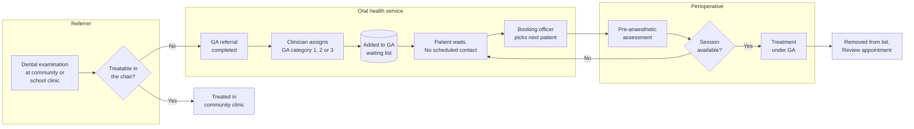
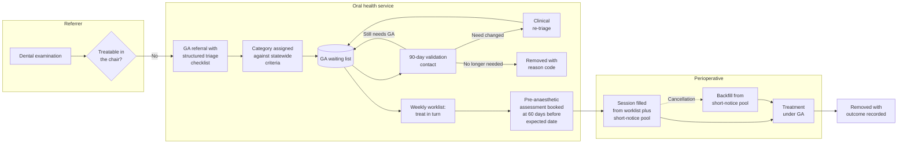

# 3. Current and future state process

The current state is reconstructed from Queensland Health's published waiting list definitions and how public dental GA services generally operate. It has not been walked through with Metro South staff. Pain points marked **(H)** are hypotheses to test in discovery; those marked **(D)** are supported by the published data.

## Current state: referral to treatment

| Step | Pain point |
|---|---|
| D. Categorisation | Category mix differs sharply between HHSs: 83% Category 2 in Metro South, 0% in Wide Bay **(D)**. Criteria are likely applied differently by individual clinicians **(H)** |
| E-F. Waiting | No scheduled contact while waiting, so changes in address, need or symptoms are not picked up **(H)**. Removals without treatment are not reported publicly, so list accuracy is unknown **(D)** |
| G. Selection | Unclear whether patients are booked in turn (category, then time waited) or by clinician or clinic availability **(H)**. Only 23% of Metro South patients treated in 2025 were treated within target **(D)** |
| H. Pre-anaesthetic | Assessment done late, close to the theatre date, so a failed assessment leaves an empty slot **(H)** |
| I. Sessions | Dental shares theatre sessions with other specialties; lost or cancelled sessions are not backfilled **(H)**. Throughput fell from ~450 to ~360 patients a year between mid-2023 and 2025 **(D)** |

## Future state

## What changes

| Change | Addresses | Owner |
|---|---|---|
| Structured triage checklist at referral, audited quarterly | Inconsistent categorisation | Senior dentist |
| 90-day validation contact with scripted call and reason codes | Stale list, unreported deterioration | Waitlist officer |
| Weekly treat-in-turn worklist (see prototype) | Patients not booked in clinical order | Booking officer |
| Pre-anaesthetic assessment brought forward | Empty slots from failed assessments | Perioperative nurse |
| Short-notice pool of assessed patients who can come in at 48 hours' notice | Lost sessions after cancellations | Booking officer |
| Removal reason codes captured and reported | Unknown list accuracy | Oral health information team |
