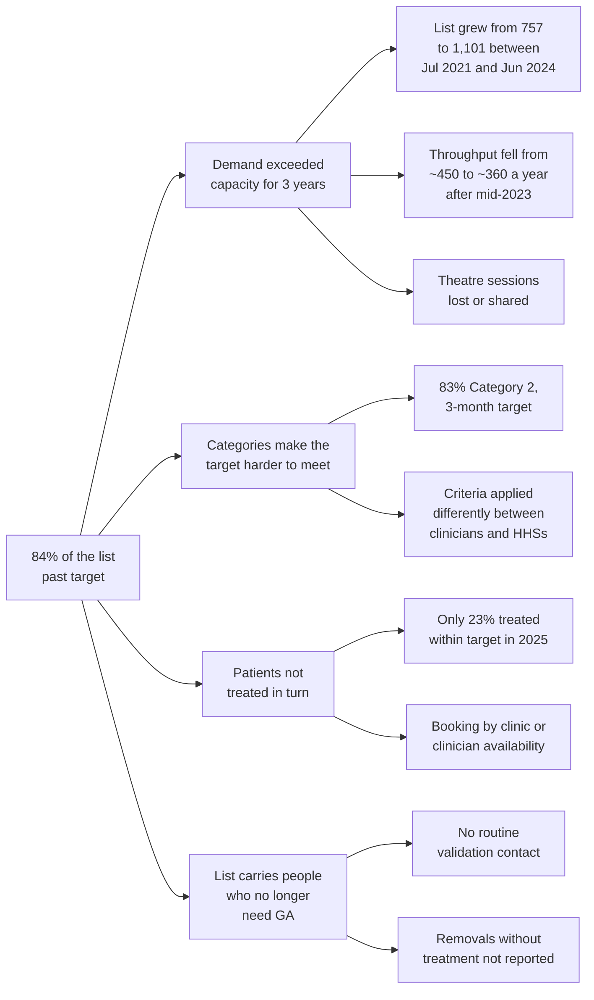

# 4. Root cause analysis

**Problem:** 84% of Metro South's GA dental list is past its clinically recommended time.

The published data supports some causes directly. Others can only be tested inside the service. Each is rated by the strength of the evidence available now.

## Cause tree

## Evidence

| # | Cause | Evidence | Strength | How to confirm |
|---|---|---|---|---|
| 1 | Demand exceeded capacity from 2021 to mid-2024 | List grew 45% in three years while throughput did not keep pace; it has fallen since June 2024 as additions slowed | **Strong** (published data) | Extract referrals by month to separate demand from removals |
| 2 | Throughput fell after mid-2023 | Patients treated in the previous 12 months fell from about 450 to about 360 | **Strong** (published data) | Theatre session data: sessions allocated, used, cancelled, and cases per session |
| 3 | Category mix makes the target harder | 83% of the list is Category 2 (3 months), vs 0% in Wide Bay and 36% in Metro North | **Strong** for the mix; **unknown** whether patients are over-categorised | Clinical audit of a sample of Category 2 referrals against the statewide criteria |
| 4 | Not treated in turn | Only 23% of patients treated in 2025 were treated within target, while 57% of the list has waited over 12 months | **Moderate**. Expected when a list is this overdue, but also consistent with out-of-turn booking | Compare booking order with waiting order for a quarter of discharges |
| 5 | List not validated | No public data on removals; long waiters are the group most likely to have moved or been treated elsewhere | **Hypothesis** | Pilot validation calls on 100 patients waiting 12+ months and record outcomes |
| 6 | Pre-anaesthetic failures and cancellations waste sessions | Not in public data | **Hypothesis** | Cancellation log by reason for the last 12 months |

## What Wide Bay may be doing differently

The data shows *that* Wide Bay keeps its list within target, not *how*. Questions for a site visit or call:

- Does Wide Bay categorise all GA patients as Category 3 by policy, and how does it manage clinical urgency within that?
- Does it have dedicated dental theatre sessions, or share them?
- How are patients booked: strict treat-in-turn, or by clinic?
- Does it validate its list routinely, and what share of patients are removed without treatment?
- Why has its list doubled since December 2023, and is there a plan for it?

The last question matters because Wide Bay's current additions (33 a month) exceed its treatment rate (25). Copying its model without understanding that trend would import a problem.

## Conclusion

Capacity is the main constraint (causes 1 and 2) and the backlog needs funded activity to clear. Causes 3 to 6 determine how much capacity is needed and whether the improvement lasts. They are cheaper to test, which is why the recommended option validates and re-triages before buying capacity.
