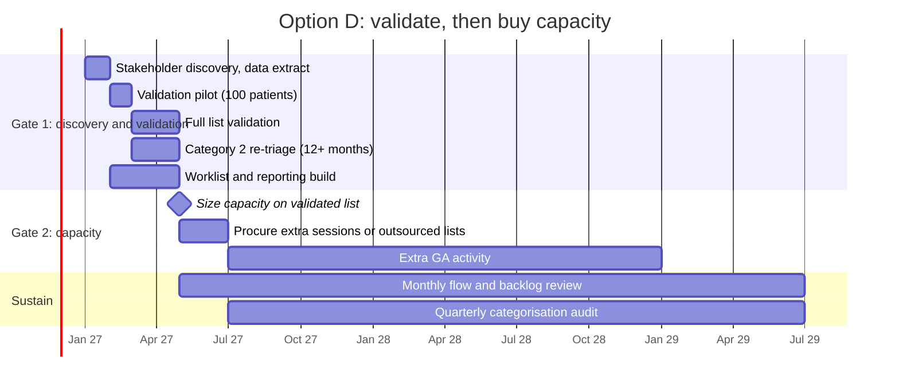

# 7. Roadmap, KPIs and risks

## Roadmap

**Gate 1 (month 4):** validated list size, removal rate, re-triage outcome and a costed capacity request go to the executive sponsor.
**Gate 2:** funding approved for the capacity sized at gate 1. Progress reported monthly against the backlog plan (RPT-03).

## KPIs

| KPI | Definition | Baseline (Dec 2025) | Target | Frequency |
|---|---|---|---|---|
| Past clinically recommended time | Waiting beyond the target for their category / total waiting | 84% (811) | Under 30% by month 24 | Monthly |
| Waited 12+ months | Waiting more than 365 days, any category / total waiting | 57% (546) | Under 5% by month 24 | Monthly |
| Treated within target | Patients treated within their category target / all treated | 23% (2025) | 70% by month 24 | Monthly |
| Clearance ratio | Treated in month / net additions in month | 1.29 (2025) | 1.0 or higher every quarter after the backlog clears | Monthly |
| List validated | Patients contacted in the last 90 days / total waiting | Not known | 95% from month 4 | Weekly |
| Session fill rate | Theatre minutes used / minutes allocated to dental GA | Not known | 90% | Monthly |

The second and third measures matter as much as the first. "% past target" can be improved by re-categorising patients without treating anyone; the 12-month measure can't.

## Risks

| Risk | Likelihood | Impact | Mitigation |
|---|---|---|---|
| Re-triage seen as gaming the KPI | Medium | High | Clinician-owned protocol; report the 12-month measure alongside; external audit of a sample |
| Vulnerable patients removed during validation | Medium | High | Three-attempt rule (VAL-04); alternative contact via carer or support provider; clinical sign-off for removals of adults with additional needs |
| Theatre capacity not available | High | High | Market sounding with private day hospitals before gate 2; weekend lists; plan B timeline of 24 months |
| Referrals rise as the list becomes more accurate and visible | Medium | Medium | Monthly clearance ratio; capacity plan reviewed quarterly |
| Data extract not available or unreliable | Medium | Medium | Agree definitions with the Performance Unit first; reconcile to published figures |
| Benchmark HHS (Wide Bay) deteriorates during the project | High | Low for this project | Share the early warning with Wide Bay; benchmark against practices, not headline numbers |
