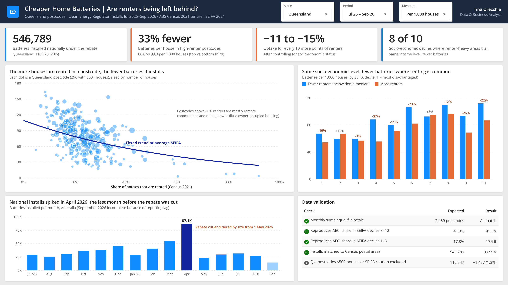

# Cheaper Home Batteries: are renters being left behind?



The federal Cheaper Home Batteries Program has subsidised more than half a million home batteries since July 2025. Earlier analysis showed uptake skews towards wealthier areas. This project asks a question that analysis left open: **do renters miss out, even at the same income level?**

## Key findings (Queensland, 296 postcodes)

| | |
|---|---|
| Batteries installed nationally, Jul 2025 – Sep 2026 | **546,789** (Queensland: 110,578) |
| High-renter vs low-renter postcodes | **66.8 vs 99.3** batteries per 1,000 houses (**33% fewer**) |
| Effect of +10 points renter share, controlling for socio-economic status | **−11% to −15%** uptake |
| Socio-economic deciles where renter-heavy postcodes trail | **8 of 10** |

Renting matters on its own: within the same SEIFA decile, postcodes where more houses are rented install fewer batteries in 8 of 10 deciles. A tenant can't install a battery on a home they don't own, and landlords have little incentive when the tenant pays the power bill.

The monthly series also shows a rush in April 2026 (87,128 installs, the highest month on record), the last month before the rebate was cut and tiered by battery size on 1 May 2026.

## Data

| Source | What | Level |
|---|---|---|
| [Clean Energy Regulator](https://cer.gov.au/markets/reports-and-data/small-scale-installation-postcode-data) | Battery installations under the Small-scale Renewable Energy Scheme, Jul 2025 – Sep 2026 | Postcode × month |
| [ABS Census 2021 DataPacks](https://www.abs.gov.au/census/find-census-data/datapacks), table G37 | Dwellings by tenure and dwelling structure | Postal area |
| [ABS SEIFA 2021](https://www.abs.gov.au/statistics/people/people-and-communities/socio-economic-indexes-areas-seifa-australia/2021) | Index of Relative Socio-economic Advantage and Disadvantage (IRSAD) | Postal area |

## Method

1. **Measure uptake fairly:** batteries per 1,000 *separate houses*, because apartments rarely qualify. Renter share is the share of separate houses that are rented.
2. **Validate the join:** reproduce the Australian Energy Council's published national split (41.0% of installs in SEIFA deciles 8–10, 17.8% in deciles 1–3). This analysis gets 41.3% and 17.9%.
3. **Compare like with like:** within each SEIFA decile, compare postcodes below and above that decile's median renter share.
4. **Estimate the effect:** weighted regression of log uptake on renter share and standardised IRSAD, weighted by number of houses.
5. **Test robustness:** re-run without postcodes above 50% renters (mostly remote communities and mining towns). The effect holds at −11%.

## Validation checks

- Monthly columns add up to the published total for all 2,489 postcodes.
- 99.99% of installations match a Census postal area.
- Queensland postcodes with fewer than 500 houses, or flagged by the ABS as unreliable for SEIFA, are excluded (1,477 installs, 1.3%).

## Limitations

- **Area-level, not household-level.** The data shows renter-heavy *areas* install fewer batteries; it can't confirm which households installed them.
- Tenure and SEIFA come from the 2021 Census; the 2026 Census results are not yet published.
- Postcodes and ABS postal areas are close but not identical.
- Recent months are incomplete because of the CER's reporting lag.

## Run it

```bash
pip install -r requirements.txt
python battery_rebate_equity.py battery.csv 2021_GCP_POA_for_AUS_short-header.zip Postal_Area_Indexes_SEIFA_2021.xlsx
```

The joined Queensland dataset is in `data/qld_postcode_dataset.csv`.

---
Tina Orecchia · Data & Business Analyst · Brisbane
