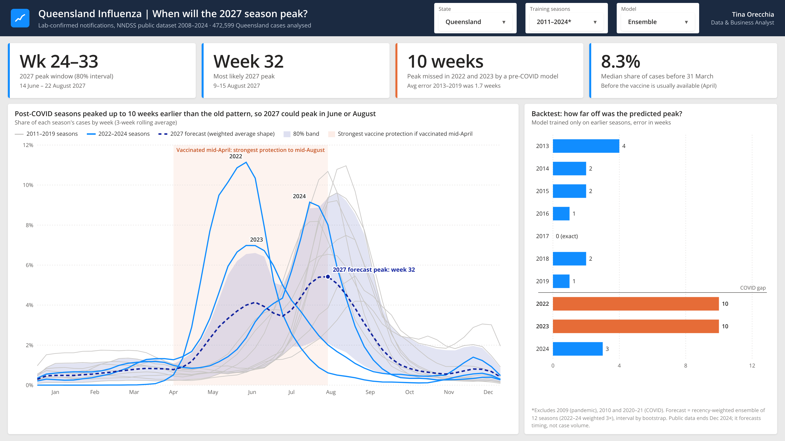

# When will Queensland's 2027 flu season peak?



A timing forecast for Queensland's 2027 influenza season, built on 472,599 lab-confirmed notifications from the National Notifiable Diseases Surveillance System (NNDSS), 2008–2024.

## The question

Aged care providers, hospitals and home care services have to decide **when** to vaccinate and staff up for flu season. Vaccines protect best in the first 3–4 months after vaccination ([ATAGI 2026](https://www.health.gov.au/sites/default/files/2026-03/atagi-statement-on-the-administration-of-seasonal-influenza-vaccines-in-2026.pdf)), so the timing of the peak matters as much as its size.

## Key findings

| | |
|---|---|
| Most likely 2027 peak | **Week 32 (9–15 August 2027)** |
| 80% interval | **Weeks 24–33 (mid-June to mid-August)** |
| Pre-COVID model accuracy, 2013–2019 | 1.7 weeks average error |
| Same model, 2022 and 2023 | **missed by 10 weeks** |
| Median share of cases before 31 March | 8.3% (before vaccines are usually available in April) |

Before COVID, Queensland's flu season peaked reliably in August. In 2022 and 2023 it peaked in June, and a model trained on the "normal" years missed by two and a half months. The 2027 forecast therefore weights post-COVID seasons more heavily, and its interval honestly reflects a real chance of an early peak.

**Practical implication:** vaccinating aged care residents as soon as the vaccine is available in April covers the full June–August risk window. Waiting until May or June risks missing an early peak.

## Method

1. **Aggregate** Queensland notifications to ISO weeks (`data/qld_weekly_notifications.csv`).
2. **Normalise** each season to a shape: the share of that season's cases in each week (3-week rolling average). This isolates timing from volume.
3. **Backtest** with an expanding window: predict each season's peak using only earlier seasons.
4. **Forecast** 2027 as a recency-weighted ensemble of 12 seasons (2011–2019 and 2022–2024, with post-COVID seasons weighted 3×).
5. **Quantify uncertainty** by bootstrapping seasons (5,000 resamples) to get an 80% interval for the peak week.

Seasons excluded: 2009 (H1N1 pandemic), 2010 (post-pandemic), 2020–2021 (COVID-19 restrictions suppressed transmission).

## Limitations

- The public NNDSS dataset currently ends in December 2024, so the 2025 and 2026 seasons are not in the model.
- This forecasts **timing**, not case numbers. Notification volumes also depend on testing behaviour, which changed substantially after 2020.
- Notifications are lab-confirmed cases only, so they understate true infections.

## Run it

```bash
pip install -r requirements.txt
python qld_flu_peak_forecast.py path/to/nndss-public-dataset-influenza.xlsx
```

Download the source file from the [NNDSS public dataset – influenza (laboratory confirmed)](https://www.cdc.gov.au/resources/publications/nndss-dataset-influenza) page. The raw file is not included in this repository; the weekly Queensland aggregate is in `data/`.

## Data source

National Notifiable Diseases Surveillance System (NNDSS), Australian Government. Data current as at 28/05/2025.

---
Tina Orecchia · Data & Business Analyst · Brisbane
