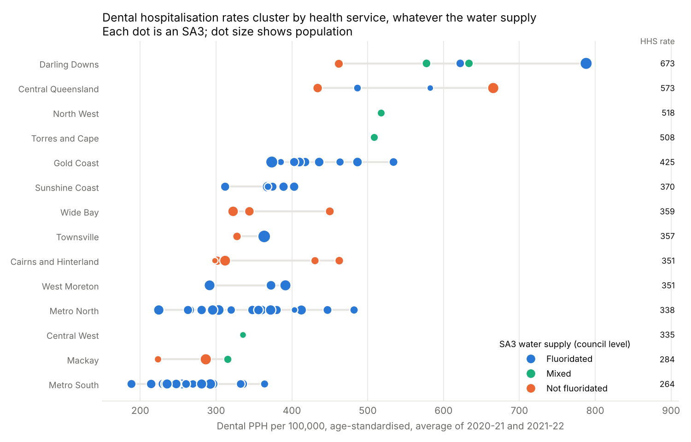
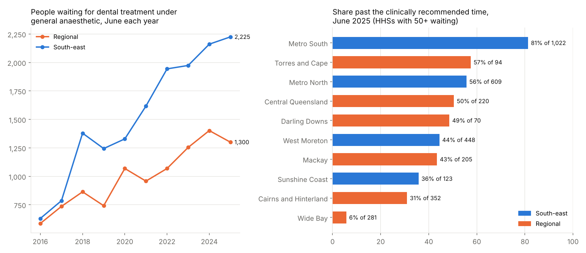

# Water fluoridation in regional Queensland: can hospital data see it?



In 2012 Queensland handed the decision to fluoridate drinking water to councils. By December 2022, 50 of 77 councils had no fluoridated supply, all of them outside the south-east, and councils are still voting on it (Cook Shire and Gympie voted to stop in 2025). The debate on both sides tends to point at hospital admissions for children's dental decay as the evidence.

This project tests that evidence directly: **do areas without fluoridated water have higher rates of potentially preventable hospitalisations (PPH) for dental conditions, and if not, what is driving the variation?**

## Key findings (82 SA3s, 2020-21 and 2021-22)

| | |
|---|---|
| Queenslanders living in a council with no fluoridated supply | **19.7%** (1.01 million) |
| Variation in dental PPH explained by **which HHS** the area sits in | **75%** |
| Explained by fluoridation status, socio-economic disadvantage and remoteness combined | **25%** (fluoridation alone: 3%) |
| Highest vs lowest HHS rate (per 100,000, age-standardised) | **Darling Downs 673** vs Metro South 264 |
| People waiting for dental treatment under general anaesthetic, June 2016 to June 2025 | **1,216 to 3,525** (+190%) |

**The hospital data can't see fluoridation.** Once areas are compared with others in the same Hospital and Health Service, SA3s without fluoridated water show *lower* dental PPH rates than their fluoridated neighbours (-18%, 90% interval -42% to -3%). That is not a sign that fluoride causes admissions. It means the indicator is mostly measuring how each HHS delivers dental care in hospital, and that signal is large enough to bury any effect of the water supply.

The clearest example is Central Queensland. Rockhampton and Gladstone both stopped fluoridating in the same period, yet Rockhampton's rate is **666** and Gladstone's is **434**, a 53% gap under the same water policy. In Darling Downs and Central Queensland, the two highest-rate HHSs, the city with the base hospital has the highest rate in its HHS (Toowoomba 788, Rockhampton 666).

**Who could act on this:** the dental PPH rate for children under 10 is a national KPI (National Oral Health Plan 2015-2024, KPI 19). HHS oral health teams and councils should not benchmark one area against another on this indicator without adjusting for the service model. For councils weighing a fluoridation decision, the published hospital data can't settle the question either way; the evidence base sits in child caries studies, not admission rates.

### What the waiting lists show



The general anaesthetic (GA) list is where severe dental disease shows up in public dental services, largely children and people with additional needs who can't be treated in the chair. It has almost tripled since 2016 and the pressure is not only regional:

| HHS, June 2025 | Waiting | Past recommended time |
|---|---|---|
| Metro South | 1,022 | **81%** |
| Torres and Cape | 94 | **57%** |
| Metro North | 609 | 56% |
| Central Queensland | 220 | 50% |
| Mackay | 205 | 43% |
| Cairns and Hinterland | 352 | 31% |
| Wide Bay | 281 | **6%** |

Wide Bay carries a list of similar size to Cairns and Central Queensland but keeps almost all of it within the clinical target. That makes it the obvious HHS to learn from on GA list management, and a better question for regional oral health services than the fluoride debate alone.

## Data

| Source | What | Level |
|---|---|---|
| [AIHW, PPH by small geographic areas 2020-21 to 2021-22](https://www.aihw.gov.au/reports/primary-health-care/potentially-preventable-hospitalisations-2020-22/data) | Dental conditions PPH, age-standardised rate per 100,000, all ages | SA3 |
| [Queensland Health, answers to questions on notice, 16 Dec 2022](https://documents.parliament.qld.gov.au/com/HEC-B5E1/HEALTHANDO-C465/Queensland%20Health%20-%20Answers%20to%20questions%20taken%20on%20notice%20at%20the%20public%20briefing%20held%20on%2016%20December%202022.pdf) | The 50 local government areas with no natural or added fluoride | Council |
| [ABS ASGS 2021 allocation files](https://www.abs.gov.au/statistics/standards/australian-statistical-geography-standard-asgs-edition-3/jul2021-jun2026/access-and-downloads/allocation-files) and [Census 2021 mesh block counts](https://www.abs.gov.au/census/guide-census-data/mesh-block-counts/latest-release) | Residents by mesh block, mapped to SA2, SA3, council and remoteness area | Mesh block |
| [ABS SEIFA 2021](https://www.abs.gov.au/statistics/people/people-and-communities/socio-economic-indexes-areas-seifa-australia/2021) | Index of Relative Socio-economic Disadvantage (IRSD) | SA2 |
| [Queensland Health public dental waiting lists](https://www.data.qld.gov.au/dataset/public-dental-waiting-list) | Clients waiting and treated by list and months waited, June each year 2016-2025 | Clinic |

## Method

1. **Build the exposure.** Allocate all 71,862 Queensland mesh blocks to SA3 and council, weight by Census residents, and flag residents living in one of the 50 councils with no fluoridated supply. Each SA3 gets a share between 0 and 1.
2. **Add the controls.** Population-weighted IRSD score and the share of residents in each remoteness area, both rolled up from SA2 and SA1.
3. **Assign each SA3 to an HHS.** HHS boundaries follow council boundaries outside Brisbane and Scenic Rim; those SA3s are assigned to the HHS covering most of their residents.
4. **Compare like with like.** Population-weighted dental PPH by exposure group, overall, within remoteness band and for regional Queensland only.
5. **Estimate and decompose.** Weighted least squares on the log of the rate, weighted by residents. Four models: fluoridation only; plus SEIFA and remoteness; HHS only; everything. 90% intervals from 2,000 bootstrap resamples of SA3s.
6. **Waiting lists.** Sum each June snapshot to HHS level. "Past recommended time" counts clients in the months-waiting bins beyond each list's clinical target (for GA Category 1, more than 1 month; Category 2, more than 3; Category 3, more than 12).

## Validation checks

- All 50 councils on the Queensland Health list match an ABS 2021 LGA name after standardising council titles.
- Mesh block allocation accounts for 5,141,003 residents against 5,156,828 published for the 2021 Census (99.7%); the gap is "no usual address" and offshore records, which have no SA3.
- **Exposure is understated.** Council-level status puts 19.7% of Queenslanders in non-fluoridated councils; Queensland Health reports roughly 28% without fluoridated water. The difference is residents of "fluoridated" councils whose own town or tank supply isn't fluoridated (for example outlying towns in Toowoomba, Western Downs and Central Highlands). This misclassification pulls estimates towards zero, so it is one more reason the data can't see a small effect.
- Waiting list HHS names were standardised: the 2025 file uses three-letter codes, and Cape York and Torres Strait NPA are combined into Torres and Cape to match current HHS boundaries.

## Limitations

- **Ecological design.** Area rates can't show which individuals drink fluoridated water or were admitted.
- **All ages.** The SA3 release only publishes all-ages rates. Fluoridation acts most on children's teeth, and the 5-9 age group has the highest dental PPH rate nationally, so an all-ages measure dilutes the signal.
- **Timing.** Exposure is the December 2022 status. Most councils stopped in 2012-2013, so 2020-22 admissions reflect close to a decade without fluoride, but changes since 2022 are not captured.
- **Waiting lists measure the public system only.** Since 2024 the GA lists are reported as one line per HHS rather than per clinic, and treated counts switched from monthly to quarterly, so treated volumes are not compared across years.

## What would answer the fluoridation question

- Child-specific (0-14) dental PPH by SA3, which AIHW holds but does not publish at that level.
- Caries data from the Queensland Child Oral Health Study or the school dental program, linked to the child's water supply.
- A before-and-after comparison for the councils that voted to stop in 2025 (Cook, Gympie), set up now so the baseline is fixed before the outcome data arrives.

## Run it

```bash
pip install -r requirements.txt
python qld_fluoridation_dental.py
```

The SA3 analysis dataset is written to `data/sa3_analysis_dataset.csv`. The population table in `data/sa3_lga_population_2021.csv` was built from the ABS mesh block, LGA, remoteness and SEIFA files listed above.

---
Tina Orecchia · Data & Business Analyst · Brisbane
